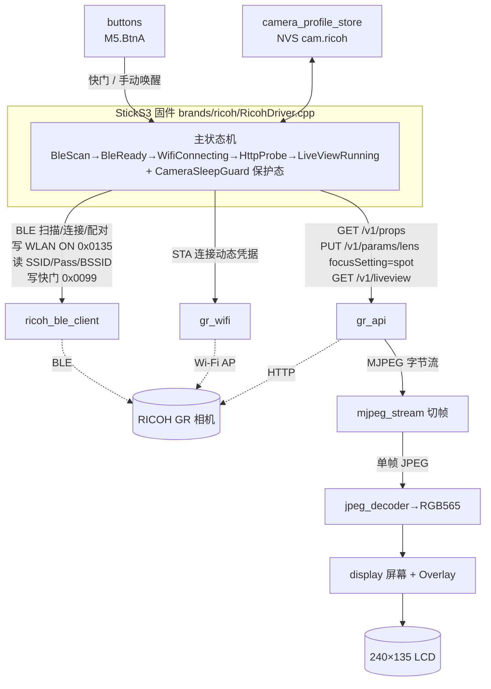

# CLAUDE.md — RICOH GR Live View Shooting

> 项目 AI 上下文索引（根级简明）。模块级详尽文档见 [`src/CLAUDE.md`](src/CLAUDE.md)。
>
> 生成时间：2026-06-29 17:19:32 CST ｜ 工具：`/ccg:init`

## 一句话概述

M5Stack StickS3（ESP32-S3）固件：以 **BLE 为唯一在线入口**识别并连接 RICOH GR 相机，经 BLE 临时唤醒相机 Wi-Fi 并读取动态 Wi-Fi 凭据，再通过 HTTP LiveView 在屏幕上显示实时 MJPEG 预览，并支持遥控快门。

## 技术栈

| 维度 | 内容 |
| --- | --- |
| 平台 | PlatformIO（`platformio.ini`），`platform=espressif32@6.12.0`，`framework=arduino` |
| 目标板 | M5Stack StickS3（ESP32-S3-PICO-1-N8R8，8MB Flash / 8MB PSRAM），`board=esp32-s3-devkitc-1` |
| 屏幕 | 240×135，经 M5Unified / LovyanGFX 渲染 |
| 关键库 | `M5Unified`、`M5PM1`、`bitbank2/JPEGDEC@^1.8.2`、`bblanchon/ArduinoJson@^7.0.0`、`h2zero/NimBLE-Arduino@2.5.0` |
| 语言 | C++17（Arduino 风格；旧模块平铺在 `src/`，新分层在 `src/{app,camera,brands,core,platform,services,supervisor,ui}/`） |
| 许可证 | GPL-3.0 |

## 构建 / 烧录 / 监控

```bash
platformio run                 # 编译
platformio run -t upload       # 烧录（upload_speed=921600）
platformio device monitor      # 串口日志（monitor_speed=115200）
platformio test -e native      # host-side 纯逻辑单元测试
platformio run -e sticks3-ricoh-gr3   # 只含 GR III 系列的固件（sticks3-ricoh-gr4 同理）
platformio test -e native-gr4  # 单型号构建下的型号选择测试（native-gr3 同理）
python scripts/check_model_includes.py  # 型号目录 include 规则
```

编译期选型号：`RVF_RICOH_GR2/GR3/GR4`（默认全开，见 `src/brands/ricoh/RicohModelSelection.h`）。依赖版本已固定为实机验证版本（M5GFX 0.2.25 / M5Unified 0.2.18 / M5PM1 1.0.7），升级需重新实机回归。

`test/` 下的 host-side native 单元测试覆盖各纯逻辑策略模块、理光工作流状态机 `RicohFlowController` 与 UI 协调器（CI 中与固件编译一起运行）；完整链路验证仍依赖真实硬件（StickS3 + RICOH GR II/III/IIIx/IV）与串口日志。

## 模块导航

`src/` 约 1.5 万行，处于「旧平铺模块 → 分层架构」迁移中。架构方向见 [`docs/refactor/multi_brand_architecture_plan.md`](docs/refactor/multi_brand_architecture_plan.md)（已定：品牌内共享采用方案 A）。

**分层目录（新）**：

| 目录 | 职责 |
| --- | --- |
| `src/camera/` | `ICameraDriver`（App → 相机驱动）/ `ICameraHost`（驱动 → 显示与输入）/ `CameraStatus` / `CameraPhase`（品牌无关连接阶段）/ `CameraRegistry`（配对引导机型列表） |
| `src/brands/ricoh/` | `RicohDriver`：理光完整工作流（BLE 唤醒、电源门控、保护态、Wi-Fi 凭据缓存、LiveView、快门、GR II 配网），由 `main.cpp` 迁入 |
| `src/app/` | `AppRuntime`：品牌无关的应用逻辑（主循环一轮、按键分发、配对引导、LiveView 锁、预览意图），经 `IAppPlatform` 调用设备能力；native 用 `SimCameraDriver` 测试 |
| `src/brands/ricoh/flow/` | `RicohFlowController` 理光工作流状态机（原 `app/AppController`），经 `RicohFlowActions` 回调驱动 `RicohDriver` 中的具体动作；`RicohFlowState` 由 `ricohCameraPhase()` 映射为 `CameraPhase` |
| `src/core/` | `AppMessage`/`AppEvent`、`Logger`、`Result`、`PeriodicTask` |
| `src/services/` | `BleCameraService`（`RicohBleClient` 门面）、`WifiPreviewService`、`CameraPowerPolicy`、`PreviewFrameBuffer` |
| `src/supervisor/` | `SystemSupervisor` 健康检查事件 |
| `src/ui/` | 按键命令、姿态、配对引导、UI 协调/动画/音效 |
| `src/brands/ricoh/common/` | 理光各型号共用：`IRicohBleProtocol`（型号协议接口）、`RicohGattSession`（GATT 原语，由 `RicohBleClient` 在 NimBLE 上实现）、协议路由、安全配置、共用 GATT UUID |
| `src/brands/ricoh/gr2/` · `gr3/` · `gr4/` | `Gr*Profile`：型号配置表（能力位与规则参数，如 `wifiRequiresOperationModeRead`、`waitsInBleStartupMode`）与安全配置，`camera_protocol_profile.cpp` 只读参数不判断型号。各型号 BLE 协议：开关相机 Wi-Fi、读电源、订阅电源通知、请求拍摄模式、读取 Wi-Fi 凭据（GR IV 文本解析在 `Gr4WifiCredentialParser`）、配对策略、型号专用 handle / UUID（`Gr3BleConfig.h` / `Gr4BleConfig.h`）；native 用 `FakeGattSession` 测试 |

**平铺模块（旧，仍是主要实现）**：

| 层 | 文件 | 职责 |
| --- | --- | --- |
| 宿主 | [`src/main.cpp`](src/main.cpp) | StickS3 设备层：`IAppPlatform` / `ICameraHost` 实现、板级（PMIC、电量、关机）、显示 / IMU / 声音、passkey 输入 UI、帧解码渲染、Supervisor、`setup()`；`loop()` 只调 `AppRuntime::tick()` |
| BLE | [`src/ricoh_ble_client.*`](src/ricoh_ble_client.h) | RICOH BLE 扫描/连接/配对、Wi-Fi 凭据读取、快门写入、电源状态通知 |
| Wi-Fi | [`src/gr_wifi.*`](src/gr_wifi.h) | ESP32 STA 连接相机 AP（支持 BSSID 锚定 + 连接守卫回调） |
| HTTP API | [`src/gr_api.*`](src/gr_api.h) | RICOH HTTP：`GET /v1/props`、`GET /v1/liveview`（MJPEG 流读取） |
| 相机身份 | [`src/camera_identity.*`](src/camera_identity.h) | 从 RICOH Wi-Fi SSID 推导候选 BLE 名称 |
| 解码渲染 | [`src/mjpeg_stream.*`](src/mjpeg_stream.h) · [`src/jpeg_decoder.*`](src/jpeg_decoder.h) · [`src/display.*`](src/display.h) | MJPEG 帧切分 → JPEG 解码到 RGB565 → 屏幕 UI/Overlay |
| 持久化 | [`src/camera_profile_store.*`](src/camera_profile_store.h) · [`src/platform/AppSettingsStore.*`](src/platform/AppSettingsStore.h) | 理光相机档案（NVS `cam.ricoh`，单个 JSON 快照：BLE 身份、Wi-Fi 缓存、IP）；应用设置（NVS `app`：显示镜像） |
| 输入 | [`src/buttons.*`](src/buttons.h) | 仅轮询 `M5.BtnA` |
| 配置 | [`src/config.h`](src/config.h) | 全局常量：BLE GATT 句柄、超时、扫描次数、缩放策略、Service UUID |
| 纯逻辑策略 | `src/*_policy.*`、`camera_profile_schema.*`、`camera_protocol_profile.*`、`gr2_*` | 可在 native 环境测试的决策逻辑 |

详细接口、依赖、状态机说明见 [`src/CLAUDE.md`](src/CLAUDE.md)。

## 架构图



## 核心状态机

`RicohDriver.cpp` 的 `CameraFlowState`（即 `rvf::RicohFlowState`，由 `RicohFlowController` 推进）：`BleScan → BleReady → WifiConnecting → HttpProbe → LiveViewRunning`，外加保护态 `CameraSleepGuard`。

- 收到相机主动断连（reason `0x213`/`0x215`）或 BLE 电源通知 `0x00` → 进入 `CameraSleepGuard`，15s 冷却期内禁止扫描/重连/Wi-Fi ON，冷却后**仍不自动唤醒**，须用户按键。
- `loop()` 周期：`handleButtons → serviceCameraFlowIfNeeded → ensureWiFi → refreshPropsIfDue → ensureLiveView → updateStatusUiIfDue`。
- LiveView 卡顿看门狗：`LIVEVIEW_STALL_TIMEOUT_MS`（5s）无有效帧即触发恢复。

## 关键约定（改代码前必读）

1. **Wi-Fi 凭据动态获取** —— 不再硬编码 SSID/密码；`platformio.ini` 无需 `GR_WIFI_SSID/PASSWORD`，凭据由 BLE 实时读取写入 `CameraProfile.wifi`。
2. **BLE GATT 句柄在 `config.h`** —— 已用 RICOH GR Android App HCI 抓包验证（2026-06-27/28），修改前先看注释。电源状态句柄 `0x00EB`/CCCD `0x00EC`、WLAN `0x0135`、快门 `0x0099`。
3. **电源门控** —— 开 Wi-Fi 前必须 `readPowerState()` 确认相机 `On`；竖持复用缓存凭据进入 BLE 快门界面前同样检查（GR IV 关机后仍可能广播 BLE）。`RICOH_BLE_REQUIRE_POWER_ON_BEFORE_WIFI=true`。手动唤醒走 `cameraManualWakeOverride` 旁路。
4. **帧缓冲在 PSRAM** —— `FRAME_BUFFER_SIZE=256KB`，优先 `MALLOC_CAP_SPIRAM`，回退内部 RAM；无 PSRAM 直接报错停机。
5. **JPEG 缩放** —— `config.h` 设 `JPEG_SCALE_POLICY=JPEG_SCALE_HALF`（覆盖 `display.h`/`jpeg_decoder.h` 的 `QUARTER` 默认）。
6. **NVS schema** —— 理光档案在 namespace `cam.ricoh` 的 `profile` 键，一个 JSON 快照（`profileVersion`=4，含 BLE 身份、代际、安全配置、Wi-Fi 缓存、相机 IP）；显示镜像在 namespace `app`。**升级固件总是整片擦除，不做任何旧数据迁移**；版本不符的快照按未配对处理。NimBLE Bond 由协议栈自行存储。保护态只在 RAM 中生效，StickS3 重启后会重新走自动连接流程。已保存 BLE 身份的 `setup()` 启动流只做一轮快速扫描，失败后交给主循环处理 KEY1 和周期重试。
7. **按键 = 仅 `M5.BtnA`** —— 见下方「文档漂移」。
8. **姿态决定链路** —— 竖持只用 BLE（相机 AP 关闭，快门走 BLE）；横持 BLE 唤醒相机 AP 后 **LiveView 期间保持 BLE 连接，快门仍走 BLE**。释放 BLE + HTTP `POST /v1/camera/shoot` 的路径（`serviceBleParking` / `shutterUsesHttp()`）代码保留，由能力位 `supportsHttpShutter && allowBlePreviewParking` 控制；因 GR III 横屏 HTTP 快门出现断连，GR III/IV 目前均关闭 `allowBlePreviewParking`。`LIVEVIEW_MAX_FPS=7`（BLE 共存下已验证的取值）。BLE 低占空比（`BLE_LIVEVIEW_LOW_DUTY_ENABLED`）默认关闭，GR IIIx 实测更差；相机状态通知在 BLE WLAN ON 之前订阅，避免阻塞取流；预览期间每 5 s 输出 `LINK:` 链路日志。详见 `docs/wifi_preview_flow.md`「BLE / Wi-Fi 共存」。

## 按键实现说明

固件使用 StickS3 `M5.BtnA` 触发 BLE 快门/保护态手动唤醒，使用 `M5.BtnPWR`/M5PM1 处理长按关机。**无 GPIO11/G11 外接快门、无 `attachInterrupt`**（早期版本曾有 G11 外接快门，已在提交 `7160103 "simplify buttons"` 中移除；README 已于 2026-06-29 同步修正）。`display.cpp` UI 文案标注「BtnA: shutter / wake」「Press BtnA to reconnect」。`liveviewEnabled` 无按键切换路径，仅被手动唤醒重置为 `true`。

## 关键配置速查

| 参数 | 默认 | 位置 | 说明 |
| --- | ---: | --- | --- |
| `BLE_SCAN_SECONDS` | 2 | config.h | 单轮 BLE 扫描时长 |
| `BLE_FAST_CONNECT_TIMEOUT_MS` | 6000 | config.h | 启动直连窗口，覆盖相机旧链路 5.12 秒监督超时 |
| `BLE_CONNECT_ATTEMPTS` | 12 | config.h | 有身份时重连尝试次数 |
| `RICOH_BLE_BONDED_SECURITY_WAIT_MS` | 1500 | config.h | 已 bonded 相机重连时的加密恢复等待 |
| `RICOH_BLE_BOND_PERSIST_SETTLE_MS` | 1000 | config.h | 新设备加密后等待 Bond 落盘，超时不保存 Profile |
| `FIRST_BOOT_BLE_PAIRING_ATTEMPTS` | 12 | config.h | 无 NVS 身份时配对扫描次数 |
| `CAMERA_POWER_OFF_COOLDOWN_MS` | 15000 | config.h | 关机断连冷却 |
| `BLE_MANUAL_WAKE_REINIT_SETTLE_MS` | 200 | config.h | 手动唤醒 BLE 栈同步重建后的稳定窗口 |
| `LIVEVIEW_STALL_TIMEOUT_MS` | 5000 | config.h | LiveView 卡顿恢复阈值 |
| `WIFI_CONNECT_TIMEOUT_MS` | 15000 | config.h | Wi-Fi 连接超时 |
| `FRAME_BUFFER_SIZE` | 256KB | config.h | JPEG 帧缓冲（PSRAM） |
| `GR_HOST` | 192.168.0.1 | config.h | 相机默认 IP（可被 NVS `cam_ip` 覆盖） |
